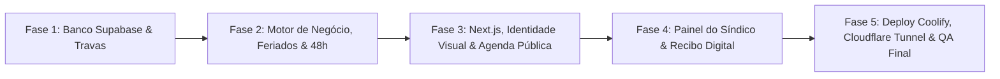

# PLAN.md — Plano de Desenvolvimento Faseado (`agenda.portalmilano.com`)

> **Projeto:** Sistema Web de Agendamento de Áreas Comuns — Milano Condomínio Club  
> **Repositório GitHub:** `https://github.com/mattosleandro/AgendaMilano.git`  
> **Metodologia Obrigatória:** Método GCCD (*Goal, Context, Constraints, Done When*)  
> **Documento de Referência:** [`AGENTS.md`](./AGENTS.md)  
> **Status Atual:** **TODAS AS FASES (1 a 5) CONCLUÍDAS E EM PRODUÇÃO** em `https://agenda.portalmilano.com` (Coolify `3nryj2sdkmtwmnsatg8jbzja` + Cloudflare Tunnel `cloudflared_milano` + `supabase-db`).

---

## Registro da Higienização Prévia Executada (Etapa Zero)

- [x] **Backup completo do banco:** salvo na VPS em `/home/ubuntu/backups/supabase_pre_agenda_cleanup_20261118_200856.sql` (`1.3 MB`).
- [x] **Remoção de container órfão:** container `portal_milano-8kgt6ljiqmtasbflvpns0eft` e rede `8kgt6ljiqmtasbflvpns0eft` removidos.
- [x] **Limpeza do schema `public`:** removidas as **15 tabelas legadas em inglês** (`assemblies`, `assembly_polls`, `assembly_votes`, `poll_options`, `bookings`, `units`, `financial_expenses`, `resident_charges`, `tickets`, `pre_deliveries`, `intercom_logs`, `intercom_configs`, `notices`, `deliveries`, `profiles`) e seus **8 enums órfãos**.
- [x] **Blindagem LGPD das tabelas existentes:** RLS ativado em `public.disparos_wa_convite` e políticas de `campanha_convite_wa*` restritas a `authenticated, service_role` (bloqueando acesso anônimo).
- [x] **Estado atual verificado:** restam apenas as **12 tabelas ativas** (5 de `unidades_milano`/WhatsApp + 7 de `assembleia_*`), todas com `rls = true` e todos os containers ativos da VPS saudáveis (`healthy`).

---

## Visão Geral das Fases Sequenciais



| Fase | Foco Principal | Dependência |
| :---: | :--- | :---: |
| **Fase 1** | Modelagem `agenda_*` no Supabase, Dupla Trava Partial Unique Index (Espaço/Data e CPF/Data), `agenda_admins`, RLS e leitura segura de `unidades_milano` | Higienização Concluída |
| **Fase 2** | Motor de Feriados (BrasilAPI + Locais), Precificação Dinâmica, Regra Dia 25 às 20h (`America/Campo_Grande`), RPC Atômica e Expiração 48h (`pg_cron` + lógica) | Fase 1 |
| **Fase 3** | Setup Next.js App Router + Identidade Visual (`./imagens`), Identificação por CPF (unificando CPF com 2 aptos) e Agenda Pública Mobile-First (LGPD) | Fases 1 e 2 |
| **Fase 4** | Painel do Síndico (`/admin`), Baixa em Espécie em 1 Clique, Recibo Digital Auditável (SHA-256) e Gestão de Feriados Locais | Fase 3 |
| **Fase 5** | Containerização `linux/arm64`, Deploy Coolify na rede `milano_net`, Rota `agenda.portalmilano.com` no Cloudflare Tunnel e Bateria Final de Testes | Fases 1 a 4 |

---

## Fase 1 — Modelagem no Supabase, Travas de Concorrência e Integração Segura com Moradores

### G — Goal (Objetivo)
Criar a fundação relacional isolada (`agenda_*`) no PostgreSQL 17.6 (`supabase-db`), garantindo integridade referencial com `public.unidades_milano`, blindagem física contra reserva dupla no mesmo espaço/data, trava física de **no máximo 1 reserva na mesma data por CPF** (unificando o caso do proprietário com 2 apartamentos sob uma única identidade de reserva), autenticação própria de administrador (`agenda_admins`) e separação estrita de dados pessoais (LGPD).

### C — Context (Contexto)
- O schema `public` está higienizado com 12 tabelas ativas (`unidades_milano`, `assembleia_*`, `campanha/wa_*`).
- `public.unidades_milano` possui 544 unidades (537 com CPF no formato `000.000.000-00`, 7 unidades vagas sem CPF; 535 CPFs com 1 unidade e 1 CPF proprietário de 2 unidades: `Bloco 20 - Apto 402` e `Bloco 28 - Apto 404`).
- Enquanto dois apartamentos estiverem sob o mesmo CPF, esse CPF representa **um único titular de agendamento** (`Bloco 20 - Apto 402 / Bloco 28 - Apto 404`), podendo realizar **no máximo 1 reserva por data**.

### C — Constraints (Restrições)
- **Zero alterações** nas 12 tabelas existentes do banco.
- Duas travas físicas obrigatórias via **Partial Unique Index** em `public.agenda_reservas`:
  1. `uq_agenda_reservas_espaco_data_ativa` em `(espaco_id, data_reserva) WHERE status IN ('PENDENTE_PAGAMENTO', 'CONFIRMADO')`.
  2. `uq_agenda_reservas_titular_data_ativa` em `(titular_cpf_hash, data_reserva) WHERE status IN ('PENDENTE_PAGAMENTO', 'CONFIRMADO')`.
- Armazenamento de valores monetários em centavos (`integer`), timestamps em `timestamptz` (UTC) e CPF do titular da reserva apenas como hash irreversível (`titular_cpf_hash` SHA-256).
- RLS habilitado em todas as tabelas `agenda_*` (acesso `anon` bloqueado para escrita e para qualquer dado sensível).

### Entregáveis Técnicos da Fase 1
1. **`supabase/migrations/001_agenda_schema.sql`** contendo:
   - **Enum `agenda_reserva_status`:** `'PENDENTE_PAGAMENTO'`, `'CONFIRMADO'`, `'EXPIRADO'`, `'CANCELADO'`.
   - **Enum `agenda_feriado_tipo`:** `'NACIONAL'`, `'ESTADUAL'`, `'MUNICIPAL'`, `'CONDOMINIO'`.
   - **Tabela `agenda_config` (singleton `id = 1`):**
     - `timezone text NOT NULL DEFAULT 'America/Campo_Grande'`
     - `dia_abertura_lote smallint NOT NULL DEFAULT 25 CHECK (dia_abertura_lote BETWEEN 1 AND 28)`
     - `hora_abertura_lote time NOT NULL DEFAULT '20:00:00'`
     - `prazo_pagamento_horas integer NOT NULL DEFAULT 48 CHECK (prazo_pagamento_horas > 0)`
     - `updated_at timestamptz NOT NULL DEFAULT now()`
   - **Tabela `agenda_admins` (Autenticação Isolada do Painel do Síndico):**
     - `id uuid PK DEFAULT gen_random_uuid()`, `username text UNIQUE NOT NULL`, `nome_exibicao text NOT NULL`, `password_hash text NOT NULL` (hash bcrypt via `pgcrypto` `crypt(..., gen_salt('bf', 12))`), `ativo boolean NOT NULL DEFAULT true`, `ultimo_login_em timestamptz`, `created_at timestamptz NOT NULL DEFAULT now()`, `updated_at timestamptz NOT NULL DEFAULT now()`.
   - **Tabela `agenda_espacos`** (com seed inicial idempotente):
     - `id uuid PK`, `slug text UNIQUE`, `nome text`, `descricao_localizacao text`, `capacidade_maxima integer`, `exige_aceite_capacidade boolean`, `preco_seg_qui_centavos integer`, `preco_sex_centavos integer`, `preco_fds_feriado_centavos integer`, `ativo boolean`, `ordem smallint`.
     - Seed exato:
       - **Salão de Festas** (`salao-de-festas`): capacidade `100`, `exige_aceite_capacidade = true`, preços `14000 / 18000 / 22000`.
       - **Quiosque 1** (`quiosque-1`): localização `"Em frente à quadra esportiva"`, `exige_aceite_capacidade = false`, preços `7000 / 9000 / 9000`.
       - **Quiosque 2** (`quiosque-2`): localização `"Em frente à quadra de areia"`, `exige_aceite_capacidade = false`, preços `7000 / 9000 / 9000`.
   - **Tabela `agenda_feriados`:**
     - `id uuid PK`, `data date UNIQUE NOT NULL`, `nome text NOT NULL`, `tipo agenda_feriado_tipo NOT NULL`, `origem text NOT NULL CHECK (origem IN ('BRASILAPI', 'MANUAL'))`, `ativo boolean NOT NULL DEFAULT true`, `created_at`, `updated_at`.
   - **Tabela `agenda_reservas`:**
     - `id uuid PK`, `espaco_id uuid NOT NULL REFERENCES agenda_espacos(id)`, `unidade_id uuid NOT NULL REFERENCES public.unidades_milano(id) ON DELETE RESTRICT`, `bloco smallint NOT NULL`, `apartamento smallint NOT NULL`, `identificacao_publica text NOT NULL` (ex: `'Bloco 01 - Apto 101'` ou `'Bloco 20 - Apto 402 / Bloco 28 - Apto 404'`), `titular_cpf_hash text NOT NULL`, `data_reserva date NOT NULL`, `status agenda_reserva_status NOT NULL DEFAULT 'PENDENTE_PAGAMENTO'`, `valor_centavos integer NOT NULL`, `regra_tarifa text NOT NULL`, `aceite_capacidade boolean NOT NULL DEFAULT false`, `aceite_capacidade_em timestamptz`, `created_at timestamptz NOT NULL DEFAULT now()`, `expires_at timestamptz NOT NULL`, `confirmado_em timestamptz`, `confirmado_por uuid REFERENCES agenda_admins(id)`, `cancelado_em timestamptz`, `cancelado_por uuid REFERENCES agenda_admins(id)`, `motivo_cancelamento text`, `updated_at timestamptz NOT NULL DEFAULT now()`.
     - **Trava Física 1 (Concorrência no Espaço/Data):**
       ```sql
       CREATE UNIQUE INDEX uq_agenda_reservas_espaco_data_ativa
         ON public.agenda_reservas (espaco_id, data_reserva)
         WHERE status IN ('PENDENTE_PAGAMENTO', 'CONFIRMADO');
       ```
     - **Trava Física 2 (Máximo 1 Reserva na Mesma Data por CPF):**
       ```sql
       CREATE UNIQUE INDEX uq_agenda_reservas_titular_data_ativa
         ON public.agenda_reservas (titular_cpf_hash, data_reserva)
         WHERE status IN ('PENDENTE_PAGAMENTO', 'CONFIRMADO');
       ```
   - **Tabela `agenda_recibos`:**
     - `id uuid PK`, `reserva_id uuid UNIQUE NOT NULL REFERENCES agenda_reservas(id) ON DELETE RESTRICT`, `codigo_recibo text UNIQUE NOT NULL`, `hash_sha256 text NOT NULL`, `bloco smallint NOT NULL`, `apartamento smallint NOT NULL`, `identificacao_publica text NOT NULL`, `espaco_nome text NOT NULL`, `espaco_descricao text`, `data_reserva date NOT NULL`, `valor_centavos integer NOT NULL`, `forma_pagamento text NOT NULL DEFAULT 'DINHEIRO_ESPECIE'`, `emitido_em timestamptz NOT NULL DEFAULT now()`, `emitido_por uuid REFERENCES agenda_admins(id)`.
     - Trigger de imutabilidade (`BEFORE UPDATE OR DELETE` bloqueia alterações em recibos emitidos).
2. **Projeção Pública Livre de PII e Funções de Identificação:**
   - View `agenda_reservas_publicas`: projeta **apenas** `id, espaco_id, data_reserva, bloco, apartamento, identificacao_publica, status_efetivo, expires_at` (sem `titular_cpf_hash` e sem vínculo com PII).
   - Função `agenda_validar_cpf_morador(p_cpf text)` (`SECURITY DEFINER`, restrita a `service_role`):
     - Normaliza os 11 dígitos do CPF;
     - Busca todas as unidades em `public.unidades_milano` daquele CPF (`ORDER BY bloco, apartamento`);
     - Retorna um objeto consolidado do titular: `unidade_principal_id`, `bloco`, `apartamento`, `quantidade_unidades`, `identificacao_publica` (`'Bloco X - Apto Y'` para 1 unidade ou `'Bloco 20 - Apto 402 / Bloco 28 - Apto 404'` para 2 unidades) e `titular_cpf_hash` (SHA-256), sem expor nome, CPF em texto puro, e-mail ou telefone.
   - Funções administrativas `agenda_autenticar_admin(p_username text, p_password text)` e `agenda_alterar_senha_admin(...)` (`SECURITY DEFINER`, restritas a `service_role`).

### D — Done When (Critérios de Conclusão)
- [x] Migração `001_agenda_schema.sql` aplicada com sucesso no `supabase-db` sem tocar nas 12 tabelas existentes.
- [x] Testes SQL comprovam as duas travas físicas: (a) dois moradores não conseguem reservar o mesmo espaço na mesma data (`uq_agenda_reservas_espaco_data_ativa`); (b) o mesmo CPF (incluindo o dono dos 2 apartamentos `20/402` e `28/404`) não consegue fazer 2 reservas na mesma data, nem em espaços diferentes (`uq_agenda_reservas_titular_data_ativa`); (c) o mesmo CPF consegue reservar normalmente em datas diferentes.
- [x] Teste SQL de `agenda_validar_cpf_morador` retorna `Bloco 20 - Apto 402 / Bloco 28 - Apto 404` unificado para o CPF com 2 unidades, rejeita as 7 unidades vagas e não retorna PII.
- [x] Conta inicial do Síndico criada em `agenda_admins` com senha criptografada via `bcrypt` (`pgcrypto`).

---

## Fase 2 — Motor de Feriados, Precificação, Regra de Abertura (Dia 25 às 20h) e Expiração 48h

### G — Goal (Objetivo)
Implementar toda a inteligência determinística de regras de negócio no banco de dados e na camada de domínio TypeScript (autoridade server-side): sincronização automática de feriados nacionais com BrasilAPI, cálculo exato de tarifas por espaço/dia/feriado, bloqueio/abertura pontual do lote no dia 25 às 20:00 (`America/Campo_Grande`) e expiração dupla (instantânea na transação + varredura `pg_cron`) após 48 horas corridas.

### C — Context (Contexto)
- O `supabase-db` opera em `UTC`, enquanto o condomínio opera em **`America/Campo_Grande` (UTC-4)**.
- O processo `pg_cron scheduler` já está ativo em `supabase-db`.
- Feriados nacionais vêm de `https://brasilapi.com.br/api/feriados/v1/{ano}` e ficam cacheados em `agenda_feriados`.
- Véspera de feriado **não** altera tarifa; feriados estaduais (MS) e municipais (Campo Grande) ativos em `agenda_feriados` aplicam a tarifa de feriado igualmente aos nacionais.

### C — Constraints (Restrições)
- O relógio do navegador nunca tem autoridade para liberar datas nem calcular expiração — toda validação usa `now()` do PostgreSQL em `America/Campo_Grande`.
- **Zero janela fantasma na expiração de 48h:** mesmo que um morador clique 1 segundo após o vencimento de uma reserva pendente (antes do próximo tick do `pg_cron`), a transação deve expirar o registro vencido atomicamente e concluir a nova reserva.
- Falhas na BrasilAPI nunca derrubam a agenda (fallback automático para `agenda_feriados`).

### Entregáveis Técnicos da Fase 2
1. **`supabase/migrations/002_agenda_motor_regras_e_cron.sql`** contendo:
   - Função `agenda_abertura_lote(p_data date) RETURNS timestamptz`: calcula o dia 25 às 20:00:00 (`America/Campo_Grande`) do mês anterior a `p_data`.
   - Função `agenda_calcular_preco(p_espaco_id uuid, p_data date)`: verifica `agenda_feriados` (`ativo = true`) e dia da semana (`ISODOW`), retornando `valor_centavos`, `regra_tarifa` e `eh_feriado`.
   - Função atômica `agenda_criar_reserva(p_espaco_id uuid, p_unidade_id uuid, p_identificacao_publica text, p_titular_cpf_hash text, p_data date, p_aceite_capacidade boolean)`:
     - Valida espaço ativo e exigência de aceite de capacidade máxima (100 pessoas no Salão de Festas);
     - Valida `p_data >= (now() AT TIME ZONE 'America/Campo_Grande')::date` e `now() >= agenda_abertura_lote(p_data)`;
     - Adquire `pg_advisory_xact_lock` para `(p_espaco_id, p_data)` e `(p_titular_cpf_hash, p_data)`;
     - Executa *lazy expiration* imediata das reservas `PENDENTE_PAGAMENTO` vencidas (`expires_at <= now()`) naquela data;
     - Insere a reserva com `expires_at = now() + interval '48 hours'`, tratando violações de `uq_agenda_reservas_espaco_data_ativa` (espaço ocupado) e `uq_agenda_reservas_titular_data_ativa` (CPF já possui reserva na mesma data) com códigos e mensagens distintas em português.
   - Função atômica `agenda_confirmar_pagamento(p_reserva_id uuid, p_admin_id uuid)`:
     - Valida `status = 'PENDENTE_PAGAMENTO'` e `expires_at > now()`;
     - Atualiza para `CONFIRMADO`, gera código `MIL-AAAA-XXXXXX` e hash SHA-256 e insere em `agenda_recibos`.
   - Função `agenda_cancelar_reserva(p_reserva_id uuid, p_admin_id uuid, p_motivo text)`.
   - Função `agenda_expirar_reservas_vencidas() RETURNS integer` + job `pg_cron` a cada 1 minuto (`* * * * *`).
2. **Módulo de Domínio Server-Side (`src/lib/agenda/`) e Testes Automatizados.**

### D — Done When (Critérios de Conclusão)
- [x] `pg_cron` habilitado e job de expiração verificado em `cron.job` executando a cada minuto sem erros.
- [x] Sincronização da BrasilAPI populando `agenda_feriados` (2026 e 2027) e feriados locais de Campo Grande/MS sem sobrescrever registros manuais.
- [x] Testes automatizados validando todos os preços (Salão R$ 140/180/220; Quiosques R$ 70/90), véspera sem alteração, abertura dia 25 às 20:00 (`America/Campo_Grande`), limite de 1 reserva por data por CPF e expiração de 48h.

---

## Fase 3 — Setup do Next.js, Identidade Visual (`./imagens`), Login por CPF e Agenda Pública Mobile-First

### G — Goal (Objetivo)
Construir a aplicação web principal em Next.js (App Router + TypeScript) com a identidade visual oficial do **Milano Condomínio Club** (`./imagens`), oferecendo aos moradores uma experiência mobile-first ultrarrápida em redes 4G/5G para consultar a agenda pública (100% aderente à LGPD), acompanhar o contador regressivo de abertura do lote e realizar reservas autenticadas por CPF.

### C — Context (Contexto)
- Ativos de marca em `./imagens`: `Logo.svg` (`#CCB285`), `LogoEscrita.svg` (`#CCB285` + `#0C0C0D`) e variantes WebP/PNG.
- Identificação por CPF unifica automaticamente o caso do proprietário com 2 apartamentos (`Bloco 20 - Apto 402 / Bloco 28 - Apto 404`) em uma única identidade de reserva.

### C — Constraints (Restrições)
- **Sigilo LGPD absoluto:** nenhuma rota pública pode expor Nome, CPF, telefone ou e-mail — o calendário exibe estritamente `identificacao_publica` (`Bloco X - Apto Y` ou `Bloco 20 - Apto 402 / Bloco 28 - Apto 404`) e o status (`Aguardando Pagamento` ou `Confirmado`).
- Sessão do morador em cookie `HttpOnly`, `Secure`, `SameSite=Lax` assinado com `SESSION_SECRET`.
- Rate limiting em `/api/auth/cpf`.
- `next.config.ts` com `output: 'standalone'`.

### Entregáveis Técnicos da Fase 3
1. **Bootstrap do Projeto Next.js + Design System Milano (`public/brand/`, `<MilanoLogo />`, `Plus Jakarta Sans` + `Inter` `tabular-nums`).**
2. **Fluxo de Identificação por CPF (`POST /api/auth/cpf`, `POST /api/auth/logout`):**
   - Validação módulo 11 + RPC `agenda_validar_cpf_morador`.
   - Exibição clara no cabeçalho do morador identificado (`Bloco X - Apto Y`, ou `Bloco 20 - Apto 402 / Bloco 28 - Apto 404` com aviso de 1 reserva máxima por data).
3. **Agenda Pública Mobile-First (`/` e `GET /api/agenda`):**
   - Abas segmentadas: **Salão de Festas** (*Capacidade máx. 100 pessoas*), **Quiosque 1** (*Em frente à quadra esportiva*) e **Quiosque 2** (*Em frente à quadra de areia*).
   - Grade mensal com preços diários, destaque de feriados, status em tempo real e **contador regressivo sincronizado com o servidor** para o lote do mês seguinte antes do dia 25 às 20:00.
4. **Modal de Reserva + Minhas Reservas (`POST /api/reservas`):**
   - Resumo completo da reserva, aviso de pagamento em dinheiro vivo ao síndico em até 48h e **checkbox obrigatório de aceite de capacidade máxima de 100 pessoas no Salão de Festas**.
   - Seção **Minhas Reservas** com prazo restante de 48h e link para o Recibo Digital após confirmação.

### D — Done When (Critérios de Conclusão)
- [x] Interface fiel a `./imagens`, responsiva (360px–desktop) e com números tabulares (`tabular-nums`).
- [x] Fluxo ponta a ponta validado: login por CPF → reserva → exibição pública apenas de `Bloco/Apto` e status → bloqueio caso o mesmo CPF tente reservar outro espaço na mesma data.
- [x] Salão de Festas exige aceite das 100 pessoas; Quiosques 1 e 2 mostram as quadras correspondentes.
- [x] Auditoria de payload HTTP/RSC confirma zero exposição de PII.
- [x] `npx tsc --noEmit` e `npm run build` limpos.

---

## Fase 4 — Painel do Síndico, Baixa em Espécie, Recibo Digital Auditável e Gestão de Feriados

### G — Goal (Objetivo)
Entregar o Painel Administrativo do Síndico (`/admin`) autenticado via `public.agenda_admins`, com confirmação de pagamento em espécie em **1 clique**, emissão automática de **Recibo Digital Auditável** (SHA-256), cancelamento manual auditado, troca de senha administrativa e gestão completa de feriados locais e nacionais (BrasilAPI).

### C — Context (Contexto)
- Pagamento feito em dinheiro vivo diretamente ao síndico dentro das 48 horas.
- Autenticação administrativa 100% isolada na nova tabela `public.agenda_admins`.

### C — Constraints (Restrições)
- Rotas `/admin` e `/api/admin/*` protegidas server-side por cookie `HttpOnly` assinado (zero segredos em `NEXT_PUBLIC_*`).
- Proibição atômica de confirmar reserva já expirada (`expires_at <= now()`).
- Recibos imutáveis em `agenda_recibos` e verificáveis publicamente em `/recibo/[codigo]` sem expor PII (exibindo apenas `Bloco/Apto`).

### Entregáveis Técnicos da Fase 4
1. **Login Administrativo (`/admin/login`) + Alteração de Senha (`/admin/senha`)** via `agenda_admins`.
2. **Dashboard de Reservas e Baixa em 1 Clique (`/admin`):**
   - Fila prioritária de reservas `PENDENTE_PAGAMENTO` com cronômetro regressivo das 48h;
   - Botão de baixa em espécie em 1 clique → gera recibo e abre opção de compartilhar link/imprimir;
   - Cancelamento manual com motivo obrigatório;
   - Filtros por mês, espaço, status e bloco/apto + resumo financeiro arrecadado em espécie.
3. **Recibo Digital Auditável (`/recibo/[codigo]`):**
   - Cabeçalho oficial com `LogoEscrita.svg`, código `MIL-AAAA-XXXXXX`, `identificacao_publica` (`Bloco/Apto`), espaço e localização, data da reserva, valor pago em espécie, data/hora da baixa (`America/Campo_Grande`), hash SHA-256 e layout `@media print`.
4. **Gestão de Feriados (`/admin/feriados`):**
   - CRUD de feriados estaduais (MS) e municipais (Campo Grande) + botão de sincronização com a BrasilAPI.

### D — Done When (Critérios de Conclusão)
- [x] `/admin` e `/api/admin/*` inacessíveis sem sessão válida de `agenda_admins`.
- [x] Baixa em 1 clique confirma a reserva e emite recibo imutável verificável em `/recibo/[codigo]`.
- [x] Gestão de feriados locais atualiza o cálculo de preços imediatamente.
- [x] `npx tsc --noEmit` e `npm run build` limpos.

---

## Fase 5 — Deploy no Coolify, Cloudflare Tunnel (`agenda.portalmilano.com`) e Bateria de Testes Finais

### G — Goal (Objetivo)
Publicar o sistema em produção via **Coolify** a partir do repositório `https://github.com/mattosleandro/AgendaMilano.git`, expor `https://agenda.portalmilano.com` via **Cloudflare Tunnel** (`cloudflared_milano`) na rede `milano_net` e concluir a bateria final de testes de concorrência, expiração 48h, LGPD e performance mobile.

### C — Context (Contexto)
- VPS `myoraclecloud` (`aarch64` / ARM64) com Coolify v4.7.5 (projeto `portal-milano`).
- Rede Docker `milano_net` conecta `cloudflared_milano` (`172.24.5.3`) e `supabase-envoy` (`172.24.5.4`).

### C — Constraints (Restrições)
- Build Docker multi-stage `linux/arm64` non-root na porta `3000` com alias estável `agenda-milano-web` na rede `milano_net`.
- Zero impacto nos containers ativos (`votar_milano`, `moradores_milano`, `supabase-*`, `cloudflared_milano`, `milano_n8n`, `milano_evolution`).
- Segredos apenas no ambiente do Coolify (zero segredos no Git).

### Entregáveis Técnicos da Fase 5
1. **`Dockerfile` (`linux/arm64`), `.dockerignore`, `.env.example` e `GET /api/health`.**
2. **Versionamento e Push para `https://github.com/mattosleandro/AgendaMilano.git` + Deploy no Coolify (`agenda-milano-web` na `milano_net`).**
3. **Roteamento `agenda.portalmilano.com` → `http://agenda-milano-web:3000` no Cloudflare Tunnel.**
4. **Bateria Final de Testes em Produção (Concorrência simultânea, limite de 1 reserva/data por CPF, expiração 48h, auditoria LGPD e performance mobile 4G).**

### D — Done When (Critérios de Conclusão)
- [x] `https://agenda.portalmilano.com` online via HTTPS com certificado válido, `/api/health` retornando `200 OK` e aplicação **Agenda Milano** (`3nryj2sdkmtwmnsatg8jbzja`) saudável no Coolify.
- [x] Container `linux/arm64` em produção na rede `milano_net` com alias `agenda-milano-web` comunicando-se com `http://supabase-envoy:8000` em baixa latência (`healthy`).
- [x] Testes de concorrência em produção HTTPS (`1x 201 + 19x 409` em 20 disparos paralelos), limite de 1 reserva/data por CPF (`409 TITULAR_JA_RESERVOU_DATA`), expiração 48h (`pg_cron` com 982 execuções `succeeded`) e auditoria LGPD 100% aprovados.
- [x] Banco de produção limpo (`0` reservas/recibos residuais de teste) e todos os serviços pré-existentes da VPS intactos e saudáveis.
